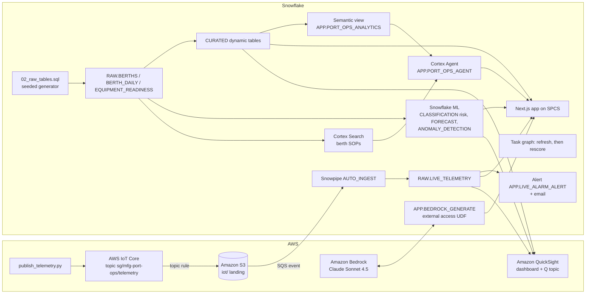

# Singapore Manufacturing Port Operations Control Tower

Berth operations monitoring for **Meranti Quay Terminals**, a fictional Singapore container terminal operator with **30 berths across 6 Singapore port districts** (Tuas, Pasir Panjang, Tanjong Pagar, Pioneer, Sembawang, Changi) that handle the export network of Halcyon Components, a fictional Singapore electronics manufacturer. It uses Snowflake, optionally with AWS: mainline, feeder, transshipment, barge and reefer berths, with on-time box moves inside each vessel's berth window, a live vessel-waiting alarm, a 7-day berth disruption-risk score, an alarm email and an AI action memo.

## Architecture

A berth control-tower pipeline built on **Snowflake** (Dynamic Tables, Snowflake ML, Cortex Search, Cortex Agent, Cortex AI_COMPLETE, SPCS) and, in the full build, **AWS** (IoT Core, S3, Bedrock Claude, QuickSight + Amazon Q). Quay sensors (vessel waiting hours, berth occupancy) land in `RAW.LIVE_TELEMETRY`. Dynamic tables curate 90 days of berth-day history: box moves, on-time box moves (completed inside the agreed berth window), yard moves, rehandle moves, disruptions and quay crane uptime. Snowflake ML scores 7-day disruption risk per berth, forecasts port-network box moves and flags vessel waiting-time anomalies. A Cortex Agent answers questions with SOP citations, and an LLM drafts the berth operations action memo.

Interactive diagrams (hover for object names): [Snowflake only](docs/architecture-snowflake.html) | [AWS + Snowflake](docs/architecture-aws.html). The app shows both on its Architecture & Data tab, the current build first. Regenerate them with `python3 docs/build_architecture.py`.



The Snowflake-only build drops the AWS subgraph: `APP.SIMULATE_TELEMETRY` writes to `RAW.LIVE_TELEMETRY`, and the app calls Cortex `AI_COMPLETE` instead of the Bedrock UDF.

## Snowflake Capabilities

| Capability | Implementation |
|-----------|---------------|
| Dynamic Tables | `CURATED.KPI_SUMMARY`, `PERFORMANCE_SUMMARY`, `DISRUPTION_CAUSES`, `TREND_ANALYSIS` from the RAW tables |
| Snowflake ML | CLASSIFICATION 7-day berth disruption risk (`ML.DISRUPTION_RISK_SCORES`), 14-day box-move FORECAST, vessel waiting-time ANOMALY_DETECTION |
| Cortex Search | 22 synthetic disruption-response SOPs (one per berth type and cause) in `SEARCH.BERTH_SOP_SEARCH` |
| Semantic View | `APP.PORT_OPS_ANALYTICS` over berths, disruption causes, daily box moves and risk |
| Cortex Agent | `APP.PORT_OPS_AGENT`: Cortex Analyst over the semantic view plus Cortex Search for SOP citations |
| Cortex AI | `AI_COMPLETE('claude-sonnet-4-5')` for grounded answers, and for the action memo in the Snowflake-only build |
| Alerts + Tasks | `APP.LIVE_ALARM_ALERT` logs ALARM readings and sends email; task graph `TASK_REFRESH_CURATED`, then `TASK_RESCORE_RISK` |
| Snowpark Container Services | Next.js app `APP.SG_MANUFACTURING_PORT_OPS_APP` with 6 tabs: Executive Cockpit, Predictive, Berth Health, Live IoT, Ask AI, Architecture & Data |
| Snowpipe | `RAW.LIVE_TELEMETRY_PIPE` AUTO_INGEST from S3 (AWS build only) |

## AWS Services

Used only in the AWS + Snowflake build.

| Service | Role in Demo |
|---------|-------------|
| AWS IoT Core | Receives simulated quay sensor telemetry (vessel waiting hours, berth occupancy). A topic rule writes each message to S3 |
| Amazon S3 | Landing bucket. An event notification goes to the Snowpipe SQS queue |
| Amazon Bedrock | Claude Sonnet 4.5 writes the action memo, called from Snowflake through an external-access UDF |
| Amazon QuickSight | DIRECT_QUERY executive dashboard over Snowflake (daily on-time box moves, disruptions by berth, disruption risk) |
| Amazon Q | Natural-language questions over the QuickSight topic `sg-manufacturing-port-ops-topic` |
| AWS IAM | Least-privilege roles for S3, IoT and Bedrock |

## Personas

These personas are fictional.

| Persona | Role | Key Questions |
|---------|------|---------------|
| **Farah Iskandar** | Head of Port Operations, Singapore, Meranti Quay Terminals | "Which port district has the lowest on-time move rate?" "Which disruption causes make the most box moves late?" |
| **Marcus Seah** | Berth Planning Lead | "Which berths are high disruption risk this week, and which SOP applies?" |

## Data

All data is synthetic and seeded, so every rebuild reproduces it. Meranti Quay Terminals, its berths and Halcyon Components are fictional; the six port districts are real Singapore places used as regions. No real port authority, terminal operator, shipping line or vessel is represented.

| Table | Rows | Description |
|-------|------|-------------|
| RAW.BERTHS | 30 | Berths across 6 Singapore port districts and 5 berth types (Mainline, Feeder, Transshipment, Barge, Reefer) |
| RAW.BERTH_DAILY | 2,700 | Daily berth observations over 90 days: box moves, on-time box moves, schedule adherence, yard moves, rehandle moves, disruptions, root cause, crane PM, vessel waiting hours and berth occupancy |
| RAW.EQUIPMENT_READINESS | 30 | Ship-to-shore, tandem-lift, mobile harbour and barge cranes, or reefer monitoring racks, required and serviceable per berth |
| SEARCH.BERTH_SOP_DOCS | 22 | Synthetic disruption-response SOPs indexed for Cortex Search |
| RAW.LIVE_TELEMETRY | Grows during the demo | Live readings from IoT Core (AWS build) or `APP.SIMULATE_TELEMETRY` (Snowflake-only build) |
| ML.DISRUPTION_RISK_SCORES | 30 | 7-day disruption probability and risk band per berth |

Container traceability: each berth-day carries on-time box moves and the schedule adherence of its vessel calls, and every SOP asks operators to record the vessel call and affected container IDs.

## Build Instructions

### Prerequisites
- Snowflake account with ACCOUNTADMIN access, and Cortex AI enabled (AI_COMPLETE, Search, Agent).
- An X-Small warehouse with auto-suspend at or below 120 s, and an existing SPCS compute pool.
- Python 3.11+, `snowflake-connector-python`, Node.js 22+, Docker and the `snow` CLI.
- App image: run `snow spcs image-registry login`, then build and push `sg-manufacturing-port-ops-app:v1` to the database's `APP.IMAGES` repository (see the header of `snowflake/07_deploy_app.sql`).
- AWS build only: `boto3`, AWS credentials for the target account (us-west-2) with Bedrock access, and QuickSight Enterprise.

### SPCS App
```
<DATABASE>.APP.SG_MANUFACTURING_PORT_OPS_APP
```

### Tests
```bash
python -m pytest aws snowflake quicksight
```

For a local run, put `SNOWFLAKE_ACCOUNT`, `SNOWFLAKE_USER`, `SNOWFLAKE_DATABASE`, `SNOWFLAKE_WAREHOUSE`, `SNOWFLAKE_AUTHENTICATOR=PROGRAMMATIC_ACCESS_TOKEN`, `SNOWFLAKE_TOKEN` and `DEMO_PLATFORM` in the environment, then run `npm --prefix app run build && npm --prefix app start`.

## Build Modes

Both modes share the same core. They differ in three places, and the app's `DEMO_PLATFORM` setting (in its SPCS spec) switches the memo provider and the Live IoT tab.

| Layer | Snowflake Only | Full AWS + Snowflake |
|---|---|---|
| Live telemetry | `CALL APP.SIMULATE_TELEMETRY(n)` inserts simulated readings into `RAW.LIVE_TELEMETRY`. This simulates a quay sensor feed; it is not Snowpipe Streaming | `aws/publish_telemetry.py` to AWS IoT Core, then S3, SQS and Snowpipe AUTO_INGEST |
| Action memo | Cortex `AI_COMPLETE('claude-sonnet-4-5')` | Amazon Bedrock Claude Sonnet 4.5 through `APP.BEDROCK_GENERATE` |
| BI and natural-language questions | The SPCS app is the dashboard; questions go to the Cortex Agent | Also a QuickSight dashboard and an Amazon Q topic |
| App setting | `DEMO_PLATFORM: snowflake` | `DEMO_PLATFORM: aws` |

### Snowflake Only

```bash
# 1. Core data and dynamic tables (guarded: new isolated database only)
python snowflake/run_core.py --database SINGAPORE_MANUFACTURING_PORT_OPS_SNOWFLAKE --warehouse <XS_WAREHOUSE> --connection <CONNECTION> --apply
# 2. Native telemetry, ML, search, semantic view, agent, alert and task graph
python snowflake/run_intelligence.py --database SINGAPORE_MANUFACTURING_PORT_OPS_SNOWFLAKE --platform snowflake --warehouse <XS_WAREHOUSE> --connection <CONNECTION> --alert-email you@example.com
# 3. App on SPCS with DEMO_PLATFORM=snowflake (push the image first)
python snowflake/run_intelligence.py --database SINGAPORE_MANUFACTURING_PORT_OPS_SNOWFLAKE --platform snowflake --warehouse <XS_WAREHOUSE> --connection <CONNECTION> --alert-email you@example.com --files 07_deploy_app.sql --compute-pool <COMPUTE_POOL>
```

During the demo:
- Run `CALL APP.SIMULATE_TELEMETRY(20)` to add live readings. For a continuous feed, run `ALTER TASK APP.TASK_SIMULATE_TELEMETRY RESUME`, and `SUSPEND` it afterwards.
- Run `EXECUTE ALERT APP.LIVE_ALARM_ALERT` to raise the alarm email.
- Run `EXECUTE TASK APP.TASK_REFRESH_CURATED` to refresh the curated tables and rescore risk.

Afterwards, drop the database or run `ALTER SERVICE APP.SG_MANUFACTURING_PORT_OPS_APP SUSPEND`.

### Full AWS + Snowflake

```bash
# 1. Core data and dynamic tables (guarded: new isolated database only)
python snowflake/run_core.py --database SINGAPORE_MANUFACTURING_PORT_OPS_AWS --warehouse <XS_WAREHOUSE> --connection <CONNECTION> --apply
# 2. AWS ingestion and Bedrock (dry run first, then --apply)
python aws/setup_aws.py --database SINGAPORE_MANUFACTURING_PORT_OPS_AWS --account <AWS_ACCOUNT_ID> --connection <CONNECTION> --apply
# 3. ML, search, semantic view, agent, alert and task graph
python snowflake/run_intelligence.py --database SINGAPORE_MANUFACTURING_PORT_OPS_AWS --platform aws --warehouse <XS_WAREHOUSE> --connection <CONNECTION> --alert-email you@example.com
# 4. App on SPCS with DEMO_PLATFORM=aws (push the image first)
python snowflake/run_intelligence.py --database SINGAPORE_MANUFACTURING_PORT_OPS_AWS --platform aws --warehouse <XS_WAREHOUSE> --connection <CONNECTION> --alert-email you@example.com --files 07_deploy_app.sql --compute-pool <COMPUTE_POOL>
# 5. QuickSight dashboard and Q topic (needs an existing Snowflake data source)
python quicksight/build_dashboards.py --database SINGAPORE_MANUFACTURING_PORT_OPS_AWS --account <AWS_ACCOUNT_ID> --principal-arn <QUICKSIGHT_USER_ARN> --data-source-arn <DATA_SOURCE_ARN> --prefix sg-manufacturing-port-ops --apply --update --with-topic
```

QuickSight objects must be shared with the QuickSight user who signs in (`--principal-arn`); otherwise the console shows nothing.

During the demo:
- Run `python aws/publish_telemetry.py --count 20` to send live readings.
- Run `EXECUTE ALERT APP.LIVE_ALARM_ALERT` to raise the alarm email.
- Run `EXECUTE TASK APP.TASK_REFRESH_CURATED` to refresh the curated tables and rescore risk.

Afterwards, `python aws/teardown_aws.py --database SINGAPORE_MANUFACTURING_PORT_OPS_AWS --account <AWS_ACCOUNT_ID> --connection <CONNECTION> --apply` removes the AWS resources and the account-level Bedrock external-access and S3 storage integrations. It leaves the email integration `SG_MANUFACTURING_PORT_OPS_EMAIL_INT`, which the Snowflake-only build also uses.

## Business Impact

Singapore port context and a Snowflake customer outcome in factory supply chains:
- **Singapore container volume** -- the Maritime and Port Authority of Singapore reports that "Our container throughput from both PSA terminals and Jurong Port crossed the 40 million TEU mark for the first time, growing by 5.4% and reaching a new record of 41.12 million TEUs compared to 39.0 million TEUs in 2023" -- [MPA media release, 15 January 2025](https://www.mpa.gov.sg/api/media/b1c14f5f-3ece-46d2-948d-70219ebde9da/mpa-media-release_strong-growth-momentum-for-maritime-singapore.pdf)
- **Transshipment is the core flow** -- the same release states "Around 90% of Singapore’s container throughput is for transshipment to other destinations." -- [MPA media release, 15 January 2025](https://www.mpa.gov.sg/api/media/b1c14f5f-3ece-46d2-948d-70219ebde9da/mpa-media-release_strong-growth-momentum-for-maritime-singapore.pdf)
- **Siemens** (Snowflake customer) in its factory supply chains: "By assigning risk scores to each material in the supply chain process and connecting all its systems and data from multiple sources in Snowflake, Siemens Data Cloud can now identify potential risks and trigger preventative actions autonomously" -- [Snowflake customer story: Siemens](https://www.snowflake.com/en/customers/all-customers/case-study/siemens-1/)

## Key Demo Numbers

These figures are synthetic and come from the seeded demo data. Forecast and anomaly figures can shift slightly with the build day.

- **30 berths**, 2,700 berth-days over 90 days, across 6 Singapore port districts and 5 berth types; **3,520,096 box moves** handled
- **On-time box moves 88.5%**; per-berth on-time rate ranges from 83.6% to 92.7%, and Tanjong Pagar is the lowest port district at 86.64%
- **399 berth disruptions** across 14 root causes; connecting vessel delays make the most box moves late (26,768)
- **Disruption-risk model** out-of-time holdout: precision 0.67, recall 0.60 at a 0.5 threshold, against a 0.51 base rate (a modest lift; present it as triage). 13 berths are high risk; the top berth is BT-0013, at 99.1%
- **14-day box-move forecast** with prediction intervals; **14 of 480** berth-days flagged as vessel waiting-time anomalies
- **Crane uptime 98.0%**, crane readiness 79.3%, 21.24 rehandle moves per 1,000 yard moves
- **22 SOPs** indexed for Cortex Search and cited by ID in agent answers

## License

Apache 2.0 — See [LICENSE](LICENSE) for details.

This is a personal demo project and is not an official Snowflake offering. It comes with no support or warranty. Industry metrics cited are from publicly available third-party research and Snowflake customer stories; they represent reported outcomes and are not guarantees of results.
